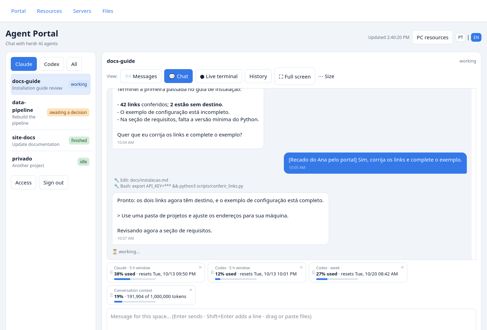
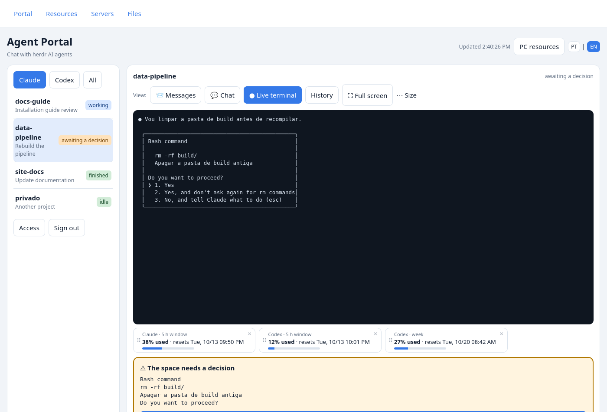
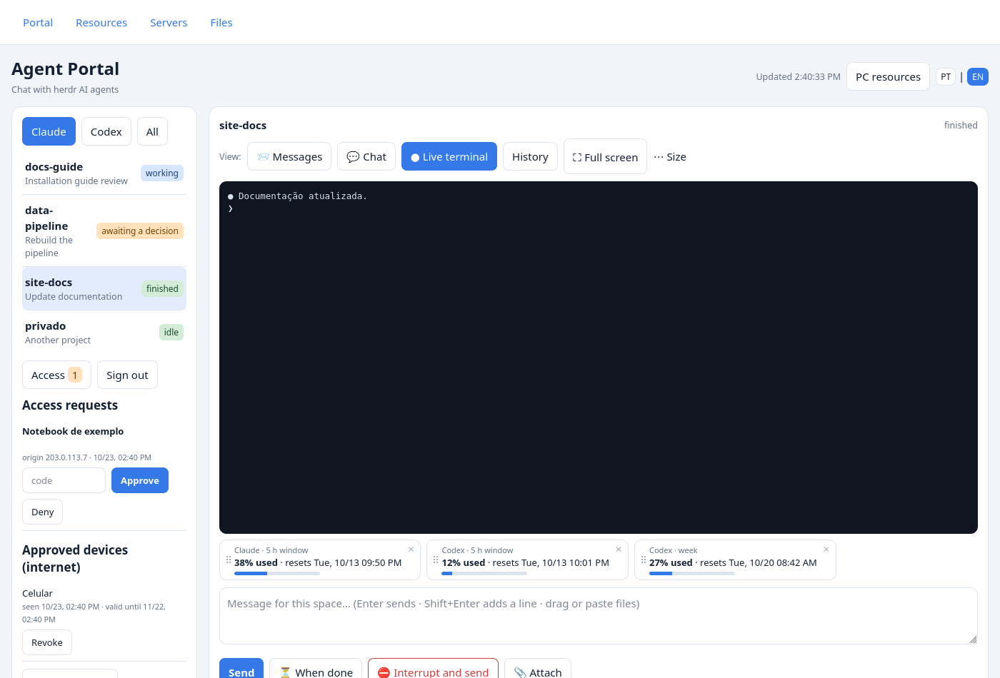
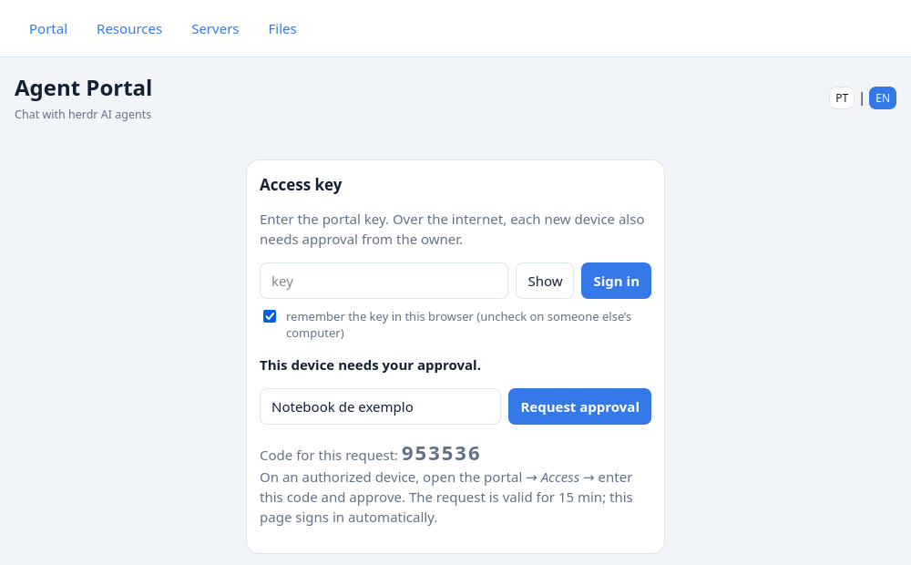
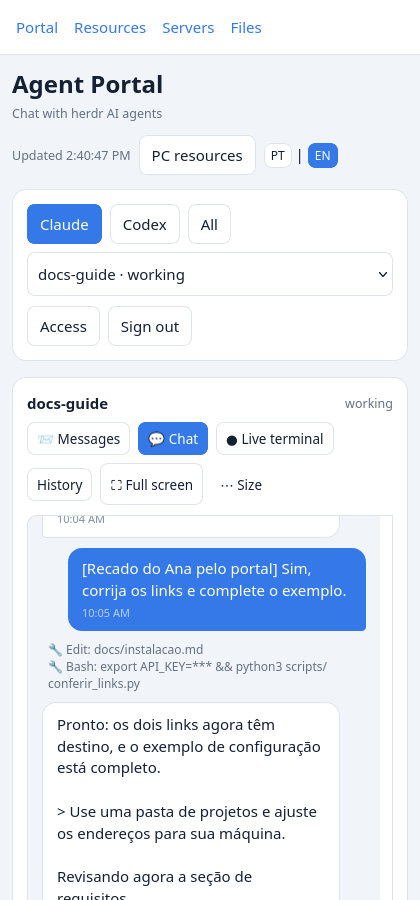
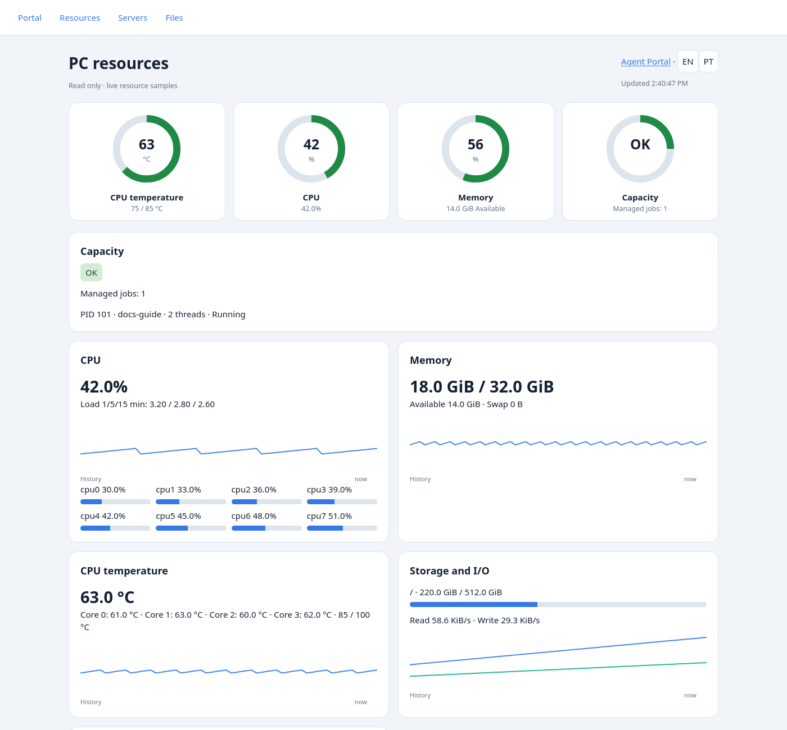
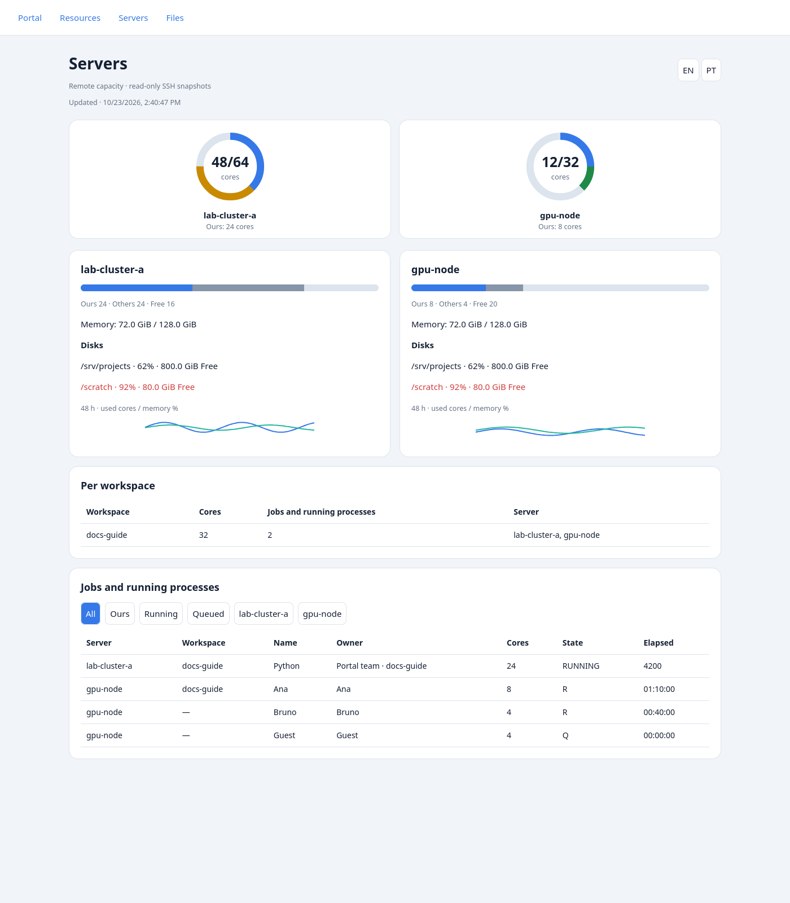
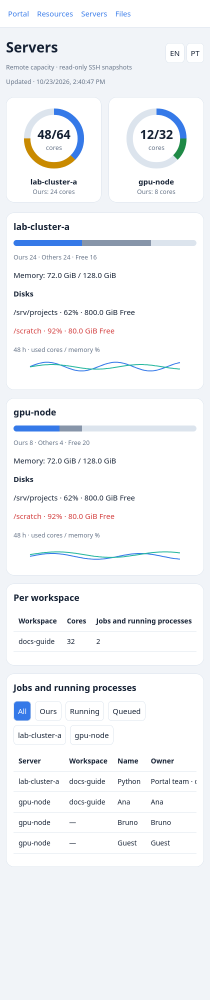
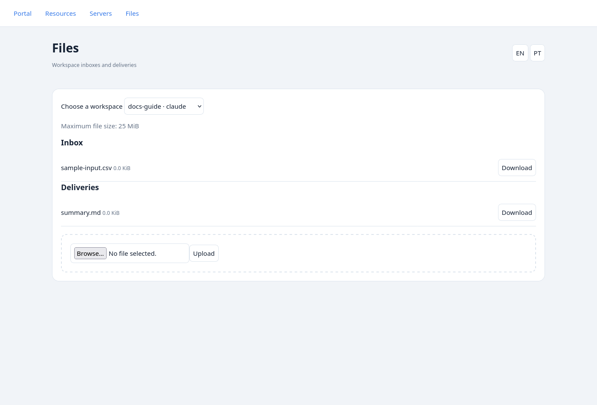
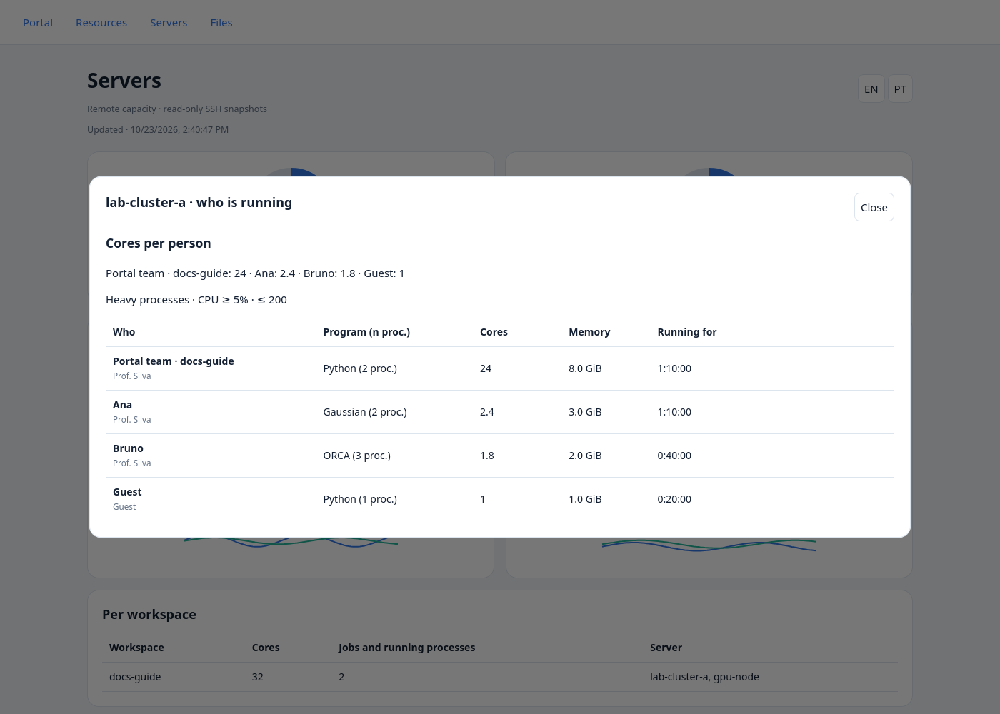

*[Versão em português](README.pt-BR.md)*

# MGE-AgentPortal

A web portal for chatting from any browser with AI agents, such as Claude Code and Codex, running in the **herdr** multiplexer on a Linux host. The server uses only the Python standard library, with no pip dependencies.

> **Security: whoever controls the portal controls the agents and, through them, the machine.** Protect the key, approve only known devices, and read [SECURITY.md](SECURITY.md) before publishing.

## Features

- Chat with Claude Code transcripts and a live terminal for Claude Code and Codex.
- A card for answering decisions, including permissions and questions. A fingerprint identifies the displayed decision and prevents answering a card that has changed.
- File uploads by selection, drag and drop, or pasting images; the paths of received files are included in the message to the agent.
- Usage-limit cards: Claude 5 h, Codex 5 h, and weekly. Drag cards by their handles between the two areas; their order is saved in this browser. Each card can be dismissed, and a button restores the cards.
- Claude/Codex/All filter, terminal history, font adjustments, and a mobile interface.
- Bilingual interface (Portuguese/English): defaults to the browser language; the **PT | EN** selector in the header saves the preference in this browser.
- Device approval and revocation, audit events, and key changes under **Access**.
- **Messages** view (default): each of your messages paired with the agent's final reply, without the tool steps in between.
- Clickable links in the chat; a notice when your message is waiting in the agent's queue (the agent is busy); multiple-choice questions (AskUserQuestion) shown as buttons even when the agent is not marked as blocked; quick replies ("go ahead", "approved").
- Message queue: while the agent works, a message is **held for 2 min** (visible, with *send now* / *cancel*; consecutive ones go together); **When done** keeps it until the agent finishes; **Interrupt and send** stops the agent (Esc) and sends. Markdown tables and pending decisions are shown inside the chat.
- Installable on the phone (PWA): add it to the home screen and use **Share → Agent Portal** from the gallery, Drive or chat apps; the portal asks before attaching what was shared.

## Images

Conversation and usage limits:



Agent decision:



Access management:



Two-step approval:



Mobile use:



The images are generated using the fictional scenario in `tests/demo.py`. Names, projects, devices, timestamps, and usage values in the demonstrations are sample data.

## Resources, servers and files

- Shared **Portal / Resources / Servers / Files** navigation, in English and Brazilian Portuguese.
- Configurable SVG resource rings, remote SSH snapshots with 48-hour history, and authenticated workspace file transfer.

### PC resources — `/resources` (also `/painel`)



Enable `painel.enabled` in `config.json`. The existing local collector powers the quick-look temperature, CPU, RAM and capacity rings and the detailed process, thermal, storage and network views. `painel.thresholds` accepts `temp_warn` / `temp_full` (°C), `cpu_warn` / `cpu_full` and `ram_warn` / `ram_full` (%); defaults are **75/85, 80/95, 80/95**. Capacity is OK, TIGHT or FULL; `min_ram_gb` (default 3), `max_load` (5.5) and power-clamp status also affect it. Missing temperature sensors display unavailable and do not block CPU/RAM assessment. The legacy `max_temp` supplies the default `temp_full` when that threshold is absent.

`painel.project_root`, `mounts`, `disk`, `job_state`, `compute_commands` and `interval` configure project attribution, storage, managed jobs, process classification and sampling. No sensor package is required. Authenticate in the Portal first; navigation opens the protected pages with the same credentials. Public access still requires an approved device and hides workspace details using `ocultos_na_internet`.

### Servers — `/servers` (also `/servidores`)





The page reads `servers.snapshot` and `servers.history` JSON files, produced by the standalone standard-library collector. Configure `servers.hosts` with `name`, `ssh` (an existing SSH alias), optional `scheduler` (`none`, `pbs`, `slurm`) and optional `cores` override. There are no built-in hosts or accounts. `servers.users` lists owners counted as ours; `servers.workspaces` maps absolute remote path prefixes to workspace/agent labels (longest complete prefix wins). Either an owner or a path match counts as ours. `servers.timeout` defaults to 20 seconds; SSH uses BatchMode and ConnectTimeout, with a total subprocess limit of timeout + 10 seconds.

The collector reads Linux load, online cores, memory, disks and processes grouped by working directory/owner; PBS (`qstat -f`) and Slurm (`squeue`) add jobs. Scheduler hosts use running allocated cores; hosts without a scheduler estimate used cores from load/process CPU. Scheduler totals cover the queue visible to the SSH account: use a host entry and cores override that represent that same scope. Process CPU from `ps` is a lifetime average, not an instantaneous measurement; inaccessible working directories remain unattributed unless the owner matches. No jobs are submitted or changed. The UI includes ours/others/free bars, disk warnings at ≥90%, workspace summaries, job filter chips and 48-hour CPU/memory sparklines. Blue ring segments represent ours. Snapshots older than 15 minutes are marked stale; unreachable hosts remain visible as unavailable.

Copy and customize `config.example.json`, set up noninteractive SSH keys and known-host entries, then run:

```sh
python3 scripts/collect_servers.py --config /path/to/config.json
```

Example cron entry (every 5 minutes; use absolute paths and the same account that runs the portal):

```cron
*/5 * * * * /usr/bin/flock -n /tmp/mge-agentportal-collector.lock /usr/bin/python3 /path/to/MGE-AgentPortal/scripts/collect_servers.py --config /path/to/config.json
```

The collector creates the output directories, publishes snapshots atomically with mode 0600 and retains 48 hours in the history JSON. Keep collection serialized, as in the cron example. A missing snapshot yields an unavailable message, without preventing Portal or Files use. Remote command permissions determine what the SSH account can observe. Private access can show owner and working-directory details; public access exposes only visible workspace rows and strips owners and remote working paths.

### Files — `/files` (also `/arquivos`)



`files.inbox` defaults to the existing `upload_pasta` (`_recebidos_portal`), and `files.outbox` defaults to `_portal_outbox`, relative to each workspace cwd. The example opts into `_portal_inbox`. `files.max_mb` defaults to `upload_mb` (25 MiB). Override `inbox` / `outbox` per workspace label under `files.workspaces`; administrator-configured absolute folders are also supported. Agents place deliveries directly into the outbox. Only immediate regular files are listed; hidden files, subfolders and symlinks are excluded. Downloads are attachments, never executable web content.

Authenticated API: `GET /api/files`, `POST /api/files/upload?pane=…&nome=…` (raw file body), and `GET /api/files/download?pane=…&kind=inbox|outbox&name=…`. Uploads reuse the existing extension allowlist, bounded streaming and unique filenames. Traversal names and symlink folders/files are rejected; hidden public workspaces cannot be selected. The legacy `/api/arquivo` preserves filename sanitization and `upload_pasta` behavior for chat attachments. Store inboxes/outboxes outside version control; newly created inboxes get a `.gitignore`.

### Reproduce the images and checks

All screenshots use only the fictional scenario in `tests/demo.py`, including remote resources and local sensor values. With Firefox installed:

```sh
.vevn/bin/python scripts/gerar_imagens.py
IDIOMA=en .vevn/bin/python scripts/gerar_imagens.py
.vevn/bin/python -m unittest discover -s tests
```

Images go to `docs/img` (PT) and `docs/img/en` (EN), including `resources.png`, `servers.png`, `files.png` and `servers-mobile.png`. English screenshots also translate project descriptions. Tests use canned collector output and a real HTTP handler over in-memory streams when TCP is unavailable; they never SSH to real hosts.

## How it works

The browser queries the portal API, which calls herdr to list agents, read the terminal, send messages, and press allowed keys. For Claude Code chat, the portal reads the local transcripts of its sessions.

There are two ports with different rules:

| Entry point | Authentication | Exposure |
| --- | --- | --- |
| Private, usually 8787 | Key only | Loopback or a configured private address, such as one on the Tailscale network |
| Public, usually 8788 | Key + approved device | Listens only on `127.0.0.1`; Tailscale Funnel publishes access over HTTPS |

At the public entry point, a new device provides its name and receives a **six-digit** code. The owner enters this code under **Access** on a trusted device. The request is valid for 15 minutes and is denied after three incorrect codes. To approve the first device, use the private entry point with the key.

## Requirements

- Linux, Python 3.10 or later, and Bash. The controller uses `flock`, `nohup`, `setsid`, and `/proc`.
- herdr installed, with Claude Code or Codex agents already open in it, under the Unix user running the portal.
- Tailscale installed, connected, and authorized to use Funnel for internet access.
- A modern browser with JavaScript and cookies enabled.
- Firefox on the `PATH` only for regenerating the images.
- Node.js only for running the JavaScript tests.

The portal neither installs nor starts the agents. To work as intended, it needs access to that user's local session data.

## Installation

Run from the root of this repository:

1. Generate the key:

   ```bash
   scripts/portal-ctl chave
   ```

   It is stored in `~/.config/mge-agentportal/token`. Treat it as a password; do not include it in URLs, commits, or screenshots.

2. Copy the configuration:

   ```bash
   cp config.example.json ~/.config/mge-agentportal/config.json
   ```

   The example starts on loopback, finds `herdr` on the `PATH`, and leaves notifications and workspace hiding unconfigured. Set `dono` to your name (`"Ana"` is fictional); if needed, set `herdr` to its absolute executable path and `aviso_cmd` to your notification command. Add sensitive workspace IDs, labels, or absolute folder prefixes (fictional example: `/home/ana/projects/private`) to `ocultos_na_internet`. If you need the private entry point over the Tailscale network, add this machine's address without opening the private port to the internet.

   Fill `hosts_permitidos` with the Hosts actually used: `127.0.0.1:8787`, `localhost:8787`, `127.0.0.1:8788`, the private Host if applicable, and `minha-maquina.tailnet-exemplo.ts.net` replaced with your machine's name. An empty list disables Host checking.

3. Start and check the service:

   ```bash
   scripts/portal-ctl start
   scripts/portal-ctl status
   ```

   On the machine itself, open `http://127.0.0.1:8787/spaces` and sign in with the key. Check that the agents appear. The runtime log is stored in `~/.config/mge-agentportal/portal.log`.

4. After completing the checklist in [PROTOCOL.md](PROTOCOL.md), publish only the public port:

   ```bash
   sudo tailscale funnel --bg 8788
   ```

   Use the HTTPS URL reported by the command; in this document, the example is `https://minha-maquina.tailnet-exemplo.ts.net/spaces`.

5. Approve the first device. On it, open the public URL, sign in with the key, enter a name, and request access. In the private session open on the machine, go to **Access**, find the request, and enter the code shown by the new device. Once approved, it signs in automatically. Subsequent devices can be approved from the private session or an already approved device.

## Everyday use

Choose the filter and the space. For Claude Code, use **Chat** to follow messages and actions; use the live view to check the terminal. Codex uses the terminal view. Terminal history may depend on the agent being idle.

Type a message and send it with Enter; Shift+Enter inserts a new line. Attach files before sending. They are stored in `_recebidos_portal` inside the space's folder, and the agent receives their paths. If sending takes a long time and fails, check the conversation before trying again.

When a decision card appears, read the question and options before answering. If the decision has changed, the server rejects the choice and asks you to check again. Dismissing a usage card only hides it in this browser; **restore cards** brings the cards back.

Under **Access**, approve known requests, deny the others, and revoke devices you no longer use. **Sign out** removes the saved key; **Forget this device** also revokes this device's access. **Change key** requires entering the current key and displays the new one; other devices will need it, but the interface keeps their approvals.

To control the process:

```bash
scripts/portal-ctl status
scripts/portal-ctl stop
scripts/portal-ctl start
```

Stopping the portal does not remove the Funnel publication. To turn it off:

```bash
sudo tailscale funnel --https=443 off
```

## Configuration

The file is `~/.config/mge-agentportal/config.json`. `MGE_PORTAL_DIR` lets you choose another directory for configuration, the key, access records, and logs; use the same value in the controller and the server. Restart the process after editing the configuration. File paths in JSON must be absolute, without `~`, except for the panel paths described below; `herdr` may also be an executable name on the `PATH`.

Existing Portuguese names remain part of the public interface: `chave` means “key” (`portal-ctl chave` generates one), `painel` means “panel”, `estado` means “state”, `herdr_falso.py` provides fake herdr, and `gerar_imagens.py` generates screenshots. Configuration keys keep their spelling; the table translates their purpose.

| Key | Default | Purpose |
| --- | --- | --- |
| `dono` | `"dono"` | Name in the message prefix; the example uses `"Ana"`. |
| `herdr` | Executable on the `PATH` or `~/.local/bin/herdr` | Executable path or name on the `PATH`. |
| `enderecos_privados` | `[["127.0.0.1", 8787]]` | Address and port pairs requiring only the key. Use ports different from `porta_publica`. |
| `porta_publica` | `8788` | Local port published by Funnel; always on `127.0.0.1`. |
| `hosts_permitidos` | `[]` | Exact accepted Host header values; an empty list does not check Host. |
| `ocultos_na_internet` | `[]` | Workspaces hidden at the public entry point, by ID, label, or absolute folder prefix. |
| `aviso_cmd` | `[]` | List of command and arguments for notifications; title, message, and priority are appended. |
| `copia_da_chave` | `""` | Additional file to copy the key to when changing it through the API; empty disables this. The `portal-ctl chave` command does not make this copy. |
| `dias_aparelho` | `30` | Validity of device approval and the device cookie. |
| `upload_mb` | `25` | Size limit per file, in MiB; the browser uses the server's configured value. |
| `upload_pasta` | `"_recebidos_portal"` | Upload subfolder inside the space's folder; keep it a simple, relative name. |
| `janela_contexto` | `1000000` | Denominator for the Claude Code context percentage. |
| `cache_uso` | `~/.claude/plugins/oh-my-claudecode/.usage-cache-anthropic.json` | Optional cache for the Claude usage limit. |
| `max_conexoes_privada` | `24` | Simultaneous connection slots per private listener. |
| `max_conexoes_publica` | `16` | Simultaneous connection slots on the public port. |

Paths containing `~` in the table describe defaults calculated by the program; when supplying them in JSON, write the absolute path. The last three optional cache and connection settings are not included in the example file.

## Tests

From the repository root:

```bash
python3 -m unittest discover -s tests -v
node --test tests/*_js_check.js
```

The tests use `tests/herdr_falso.py`, a temporary HOME, isolated configuration, fictional transcripts, and local ports. They do not need real herdr, agents, or Tailscale. They check authentication, code-based approval, cookies and headers, workspace hiding, conversation, limits, fingerprinted decisions, messages, and uploads, including interrupted transfers.

## Regenerating the images

With Firefox available on the `PATH`, run:

```bash
python3 scripts/gerar_imagens.py
```

The script starts a server with fake herdr, collects API responses, and captures the interface using headless Firefox. It recreates the five PNGs in `docs/img`, without requiring real agent accounts. Run `IDIOMA=en python3 scripts/gerar_imagens.py` for the matching English images in `docs/img/en`. It also works through the test suite's in-memory HTTP transport when TCP is unavailable.

## Limitations

- The interface is available in Portuguese and English and depends on the screen and data formats produced by the agents and herdr.
- Chat and context status are read from Claude Code transcripts. Codex has a terminal and usage limits, without transcript-based chat in this implementation.
- Claude limits come from the optional oh-my-claudecode cache. Codex limits come from recent local records. Cards may be missing or show outdated data; they do not query accounts directly.
- Context is estimated from recorded usage; both the percentage and caption use the configured `janela_contexto`.
- Updates use periodic polling; the terminal is not a full interactive session. Available keys are restricted.
- Secret masking is heuristic and does not replace reviewing what appears on screen. Uploads are not scanned for malware.

License: [MIT](LICENSE).

## Optional PC resources panel

Disabled by default. Set `painel.enabled` to `true` in the private configuration and restart. The panel expands `~` in its project and job-state paths.

| Key inside `painel` | Default | Purpose |
| --- | --- | --- |
| `enabled` | `false` | Enable the read-only panel. |
| `project_root` | `~/projects` | Group processes by the first directory below this root. |
| `disk` | `""` | Device from `/proc/diskstats` to measure; empty disables disk rates. |
| `mounts` | `["/"]` | Filesystems to show. |
| `job_state` | `~/.local/state/mge-localcompute/state.json` | Optional [MGE-LocalCompute](https://github.com/MrGoulart3/MGE-LocalCompute) integration; missing files or `""` yield no managed jobs. A compatible JSON contains `jobs` with `pid`, `threads`, `cwd`, and optional `paused`. |
| `interval` | `3` | Sampling interval in seconds, minimum 1. |
| `min_ram_gb` | `3` | Minimum available RAM in GiB for the capacity indicator. |
| `max_load` | `5.5` | Maximum 1-minute load for the capacity indicator. |
| `max_temp` | `85` | CPU package temperature ceiling in °C for the capacity indicator. |
| `compute_commands` | `["xtb", "crest", "orca", "sella", "rodar_local"]` | Case-insensitive substrings for classifying compute processes. Existing tool names are kept for compatibility; replace with your programs or use `[]` to disable this category. `rodar_local` means “run locally”. |

RAM, load, and temperature thresholds are configurable display defaults; the portal never changes thread counts or pauses jobs. Choose values for your hardware. CPU package/core parsing currently targets the Linux `coretemp` driver; other hardware may have unavailable readings. The capacity indicator is conservative when the package sensor is unavailable. Sensor thresholds use fallbacks of 85 °C (high) and 105 °C (critical); the temperature graph uses the critical threshold.

After signing in, use **PC resources** in the portal header; it opens an authenticated `/painel` in another tab. The key is sent in request headers, never in the URL. Popups must be allowed. To reopen after a full browser refresh, return to `/spaces` and use the button again. `/painel` and `/api/estado` require the key; the public port also requires an approved device. When disabled, panel routes return 404.

The collector reads Linux CPU/per-core utilization, RAM/swap, load, temperature and power-clamp, disk/network rates, process groups by project, managed jobs and a bounded in-memory history. It does not read account names or expose command arguments and executable paths. The public response permits only project details mapped to visible portal workspaces and omits hidden/unmapped processes and jobs; filtering failures return 503. If hidden and visible nested workspaces share one top-level project, that entire project group is omitted. Global totals and history still include the whole machine. Private access shows all collected projects. Missing sensors, unreadable process directories or an unconfigured disk may leave some values unavailable. RSS sums can count shared pages more than once.

The test suite automatically uses the real HTTP handler over in-memory byte streams when the environment blocks local TCP sockets. All route/body assertions still run, including interrupted uploads; listener binding, TCP concurrency and socket-level timeouts require a socket-enabled environment. The normal transport remains TCP where permitted.

Click a server ring or card (Enter/Space also works) to see **who is running**: cores per person, responsible person, program and process count, memory and running time. Scheduler jobs are grouped by person and state, with job count, allocated cores and longest running time. `servers.process_cpu_min` keeps its default of `5`; the top 40 qualifying processes are grouped by person, responsible person and executable program. Collector helpers and shells are skipped.

The identity-only privacy model replaces `servers.show_other_users`: all accounts remain visible, but no process working directories, command lines or scheduler job names are stored or returned, including for our own work. Old snapshots are stripped of those fields at the API boundary; regenerate them to remove old on-disk data. Configure `servers.accounts` as `{"lab": {"responsible": "Prof. Silva", "shared": true}, "guest": {"responsible": "Guest", "shared": false}}` and `servers.aliases` as `{"ana": "Ana", "bruno": "Bruno", "guest": "Guest"}`. Personal accounts use their aliased account name. Shared accounts use the first non-scratch person folder under `/home/<account>/` or `<base_dir>/<account>/`, searching the working directory then command arguments. Set `servers.base_dirs` for additional roots (for example `/srv/storage`); `scratch`, `g16_scratch`, `tmp`, `software`, `opt` and `bin` are ignored. Unknown people show `? (account)`. `servers.workspaces` maps complete path prefixes to workspace labels; matching work shows `servers.workspace_owner` plus the workspace. This prefix mapping alone determines workspace attribution. Responsible names come from accounts; aliases/account names provide the fallback. Scheduler jobs use their owner and working directory under the same rules. Re-run the collector after changing configuration.


