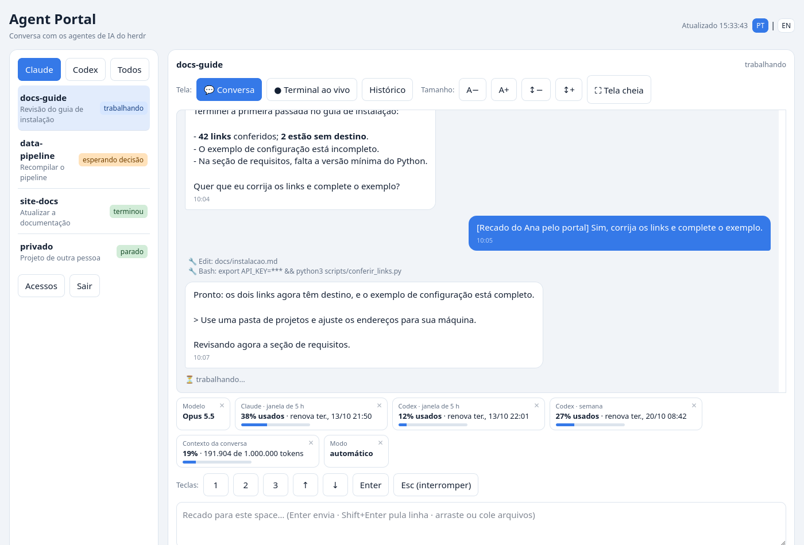
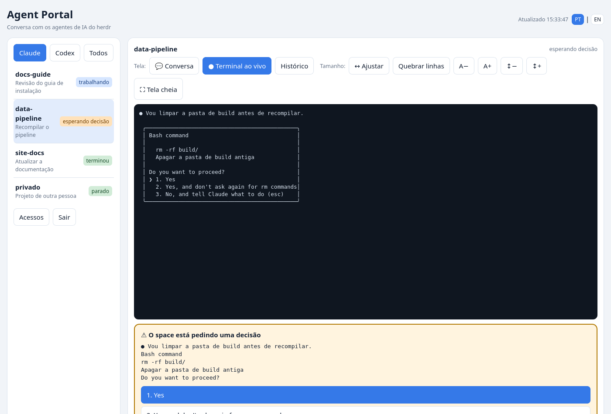
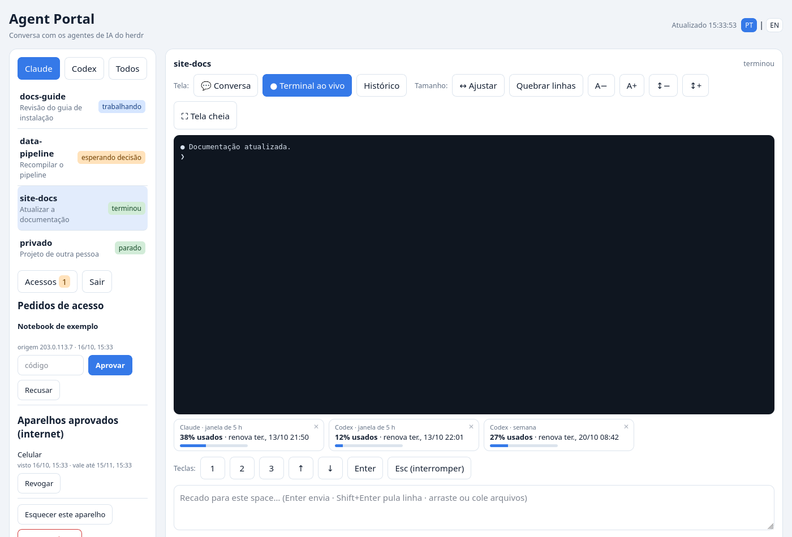
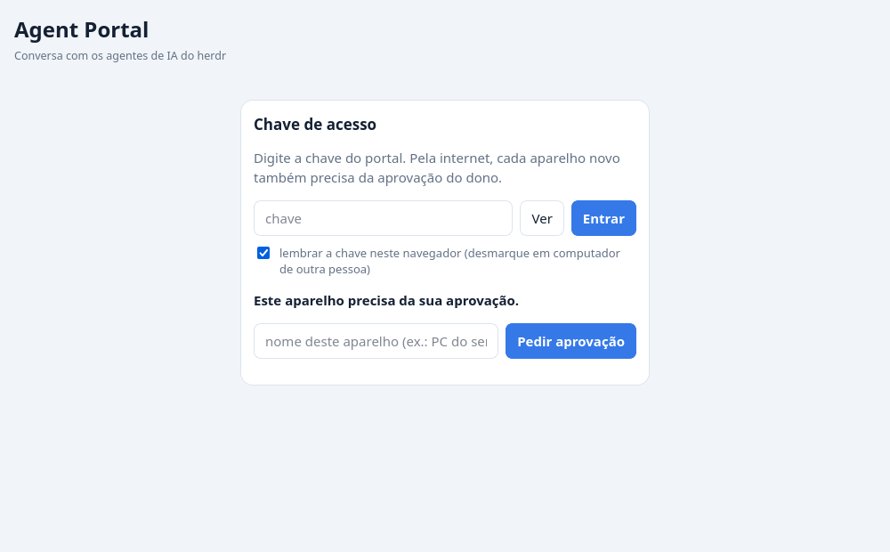
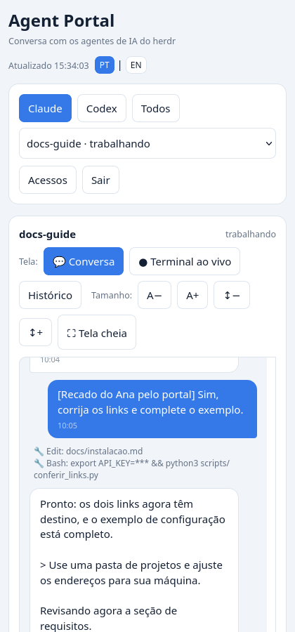
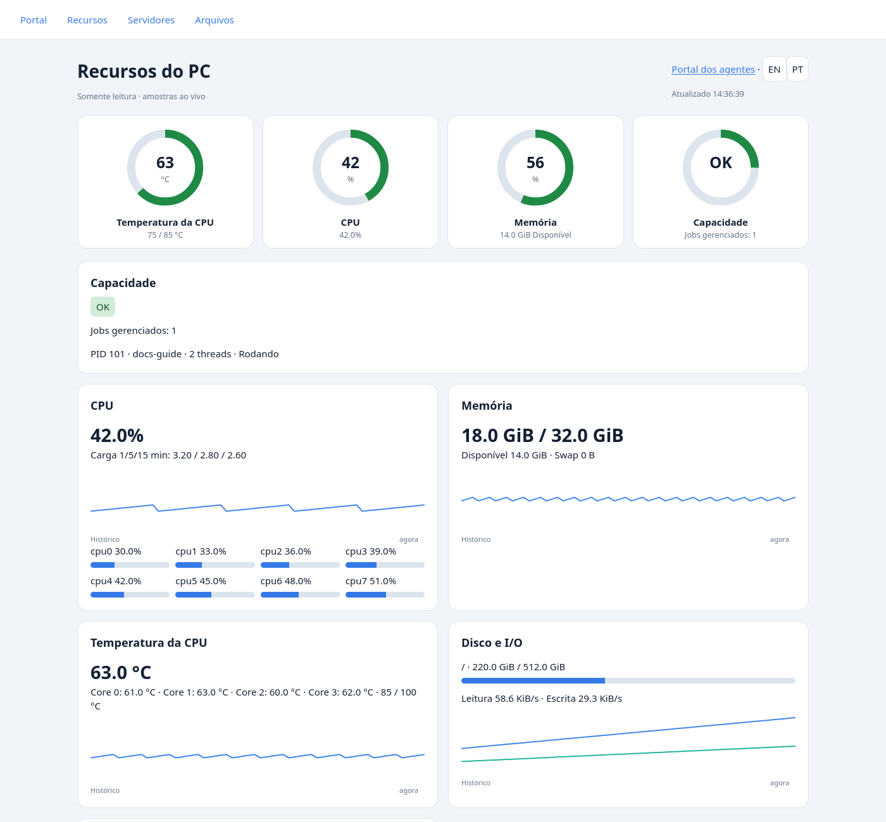
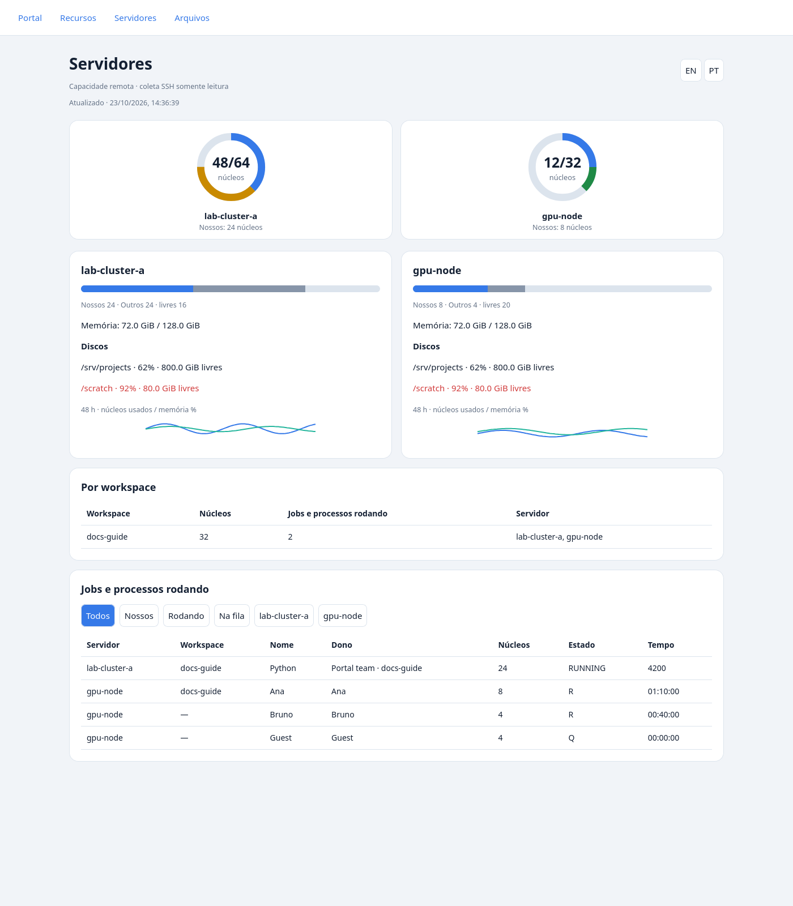
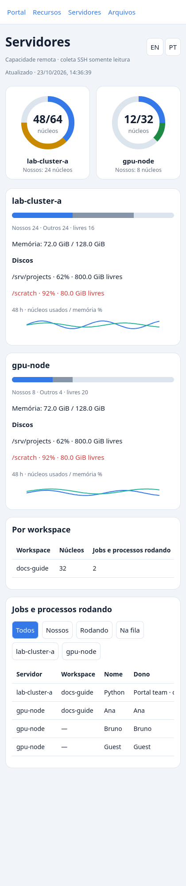
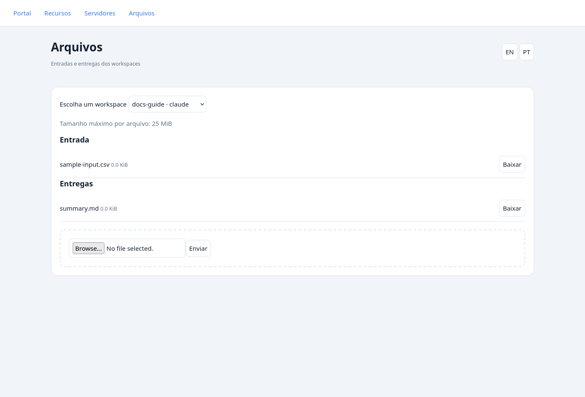
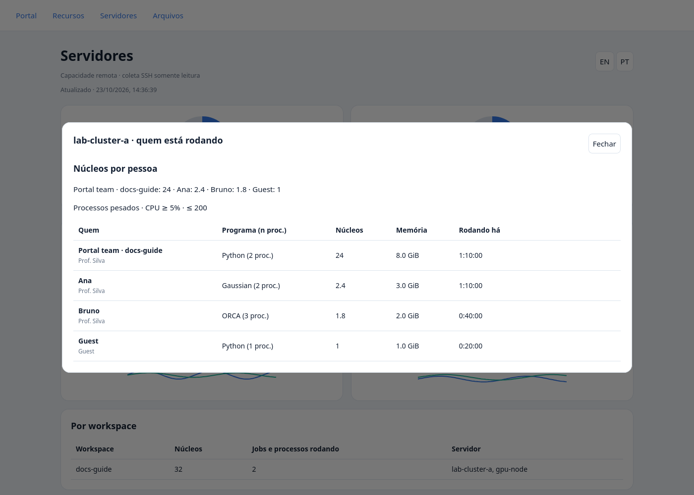

*[English version](README.md)*

Perguntas do Claude Code aceitam várias abas e múltipla escolha: use **Confirm checked (Enter)**, **Previous question**, **Next / Submit** ou as teclas ←/→/Tab/Space. Os anéis dos servidores agrupam nosso uso por workspace/projeto e os demais por usuário; o arco externo marca nossa parte, com legendas separadas e faixa de nível do uso total.

# MGE-AgentPortal

Portal web para conversar de qualquer navegador com agentes de IA, como Claude Code e Codex, que rodam no multiplexador **herdr** de uma máquina Linux. O servidor usa somente a biblioteca padrão do Python, sem dependências de pip.

> **Segurança: quem controla o portal controla os agentes e, por eles, a máquina.** Proteja a chave, aprove apenas aparelhos conhecidos e leia [SECURITY.pt-BR.md](SECURITY.pt-BR.md) antes de publicar.

## Recursos

- Chat com a transcrição do Claude Code e terminal ao vivo para Claude Code e Codex.
- Cartão para responder decisões, incluindo permissões e perguntas. A impressão digital identifica a decisão exibida e impede responder a um cartão que mudou.
- Envio de arquivos por seleção, arrastar e soltar ou colar imagens; os caminhos dos arquivos recebidos seguem no recado ao agente.
- Cartões de limites de uso: Claude 5 h, Codex 5 h e semana. Arraste os cartões pelas alças entre as duas áreas; a ordem fica salva neste navegador. Cada cartão pode ser fechado e há um botão para restaurar os cartões.
- Filtro Claude/Codex/Todos, histórico do terminal, ajustes de fonte e interface para celular.
- Interface bilíngue (português/inglês): usa o idioma do navegador por padrão; o seletor **PT | EN** no cabeçalho salva a preferência neste navegador.
- Aprovação e revogação de aparelhos, auditoria e troca de chave em **Acessos**.
- Modo **Recados** (padrão): cada recado seu com a resposta final do agente, sem os passos de ferramenta no meio.
- Links clicáveis na conversa; aviso quando o recado está na fila do agente (ocupado); perguntas de múltipla escolha (AskUserQuestion) em botões mesmo quando o agente não está marcado como bloqueado; respostas rápidas ("pode seguir", "pode publicar").
- Fila de recados: com o agente trabalhando, o recado fica **2 min em espera** (visível, com *enviar já* / *cancelar*; seguidos vão juntos); **Quando terminar** guarda até o agente terminar; **Interromper e enviar** para o agente (Esc) e envia. Tabelas markdown e decisões pendentes aparecem dentro da conversa.
- Instalável no celular (PWA): adicione à tela inicial e use **Compartilhar → Agent Portal** a partir da galeria, do Drive ou de apps de conversa; o portal pergunta antes de anexar o que foi compartilhado.

## Imagens

Conversa e limites de uso:



Decisão do agente:



Gerenciamento de acessos:



Aprovação em duas etapas:



Uso no celular:



As imagens são geradas com o cenário fictício de `tests/demo.py`. Nomes, projetos, aparelhos, datas e valores de uso nas demonstrações são dados de exemplo.

## Recursos, servidores e arquivos

- Navegação compartilhada **Portal / Recursos / Servidores / Arquivos**, em português brasileiro e inglês.
- Anéis SVG configuráveis, coleta remota por SSH com histórico de 48 horas e transferência autenticada de arquivos por workspace.

### Recursos do PC — `/resources` (também `/painel`)



Ative `painel.enabled` no `config.json`. O coletor local existente alimenta os anéis de temperatura, CPU, RAM e capacidade, além dos detalhes de processos, temperaturas, disco e rede. `painel.thresholds` aceita `temp_warn` / `temp_full` (°C), `cpu_warn` / `cpu_full` e `ram_warn` / `ram_full` (%); os padrões são **75/85, 80/95, 80/95**. A capacidade aparece como OK, APERTADO ou LOTADO; `min_ram_gb` (padrão 3), `max_load` (5,5) e power-clamp também influenciam. Sensores ausentes aparecem como indisponíveis e não impedem a avaliação de CPU/RAM. O antigo `max_temp` fornece o padrão de `temp_full` quando esse limiar estiver ausente.

`painel.project_root`, `mounts`, `disk`, `job_state`, `compute_commands` e `interval` configuram atribuição por projeto, armazenamento, jobs gerenciados, classificação e intervalo. Não exige pacote de sensores. Entre primeiro no Portal; a navegação abre as páginas protegidas com as mesmas credenciais. O acesso público continua exigindo aparelho aprovado e oculta detalhes dos workspaces por `ocultos_na_internet`.

### Servidores — `/servers` (também `/servidores`)





A página lê os JSONs `servers.snapshot` e `servers.history`, produzidos pelo coletor independente, que usa somente a biblioteca padrão. Configure `servers.hosts` com `name`, `ssh` (alias SSH existente), `scheduler` opcional (`none`, `pbs`, `slurm`) e `cores` opcional para sobrescrever a capacidade. Não há hosts ou contas embutidos. `servers.users` lista os donos considerados nossos; `servers.workspaces` associa prefixos absolutos remotos a nomes de workspace/agente (vence o prefixo completo mais específico). Basta corresponder ao dono ou ao caminho. `servers.timeout` tem padrão de 20 segundos; SSH usa BatchMode e ConnectTimeout, com limite total do subprocesso de timeout + 10 segundos.

O coletor lê carga, núcleos online, memória, discos e processos Linux agrupados por pasta de trabalho/dono; PBS (`qstat -f`) e Slurm (`squeue`) acrescentam jobs. Hosts com escalonador usam núcleos alocados por jobs rodando; sem escalonador, estimam núcleos usados pela carga/CPU dos processos. Os totais do escalonador abrangem a fila visível à conta SSH: use uma entrada e capacidade que representem esse mesmo escopo. A CPU de `ps` é uma média desde o início do processo; pastas inacessíveis ficam sem atribuição, salvo correspondência do dono. Nenhum job é lançado ou alterado. A interface mostra barras nossos/outros/livres, alertas de disco em ≥90%, resumo por workspace, filtros de jobs e gráficos de CPU/memória das últimas 48 horas. O azul nos anéis representa nossos cálculos. Coletas com mais de 15 minutos ficam sinalizadas; hosts inacessíveis continuam aparecendo como indisponíveis.

Copie e ajuste `config.example.json`, configure chaves SSH sem interação e entradas de hosts conhecidos e execute:

```sh
python3 scripts/collect_servers.py --config /caminho/config.json
```

Exemplo de cron (a cada 5 minutos; use caminhos absolutos e a mesma conta do portal):

```cron
*/5 * * * * /usr/bin/flock -n /tmp/mge-agentportal-collector.lock /usr/bin/python3 /caminho/MGE-AgentPortal/scripts/collect_servers.py --config /caminho/config.json
```

O coletor cria as pastas, publica snapshots atomicamente com modo 0600 e retém 48 horas no JSON de histórico. Serialize as execuções, como no cron acima. Snapshot ausente mostra indisponibilidade e não impede o uso do Portal ou de Arquivos. As permissões remotas determinam o que a conta SSH consegue observar. O acesso privado pode mostrar donos e pastas de trabalho; o público expõe apenas linhas de workspaces visíveis, removendo donos e caminhos remotos de trabalho.

### Arquivos — `/files` (também `/arquivos`)



`files.inbox` usa por padrão o `upload_pasta` existente (`_recebidos_portal`); `files.outbox` tem padrão `_portal_outbox`, relativos à pasta de trabalho de cada workspace. O exemplo escolhe `_portal_inbox`. `files.max_mb` usa `upload_mb` como padrão (25 MiB). Sobrescreva `inbox` / `outbox` por nome de workspace em `files.workspaces`; pastas absolutas configuradas pelo administrador também são aceitas. Agentes colocam entregas diretamente no outbox. Só arquivos regulares imediatos são listados; arquivos ocultos, subpastas e symlinks ficam de fora. Downloads são anexos, nunca conteúdo web executável.

API autenticada: `GET /api/files`, `POST /api/files/upload?pane=…&nome=…` (corpo bruto) e `GET /api/files/download?pane=…&kind=inbox|outbox&name=…`. O envio reutiliza extensões permitidas, streaming limitado e nomes únicos existentes. Nomes com travessia e pastas/arquivos symlink são rejeitados; workspaces ocultos na porta pública não podem ser selecionados. O antigo `/api/arquivo` preserva a sanitização do nome e `upload_pasta` dos anexos do chat. Mantenha inboxes/outboxes fora do controle de versão; inboxes criados recebem `.gitignore`.

### Reproduzir imagens e verificações

As imagens usam somente o cenário fictício de `tests/demo.py`, incluindo dados remotos e sensores locais. Com Firefox instalado:

```sh
.vevn/bin/python scripts/gerar_imagens.py
IDIOMA=en .vevn/bin/python scripts/gerar_imagens.py
.vevn/bin/python -m unittest discover -s tests
```

As saídas ficam em `docs/img` (PT) e `docs/img/en` (EN), incluindo `resources.png`, `servers.png`, `files.png` e `servers-mobile.png`. As imagens em inglês também traduzem as descrições dos projetos. Os testes usam saídas de coleta gravadas e o handler HTTP real com streams em memória quando TCP está indisponível; nunca fazem SSH para hosts reais.

## Como funciona

O navegador consulta a API do portal, que chama o herdr para listar agentes, ler o terminal, enviar recados e pressionar teclas permitidas. Para o chat do Claude Code, o portal lê as transcrições locais de suas sessões.

Há duas portas com regras diferentes:

| Entrada | Autenticação | Exposição |
| --- | --- | --- |
| Privada, normalmente 8787 | Só chave | Loopback ou endereço privado configurado, por exemplo da rede Tailscale |
| Pública, normalmente 8788 | Chave + aparelho aprovado | Escuta somente em `127.0.0.1`; o Tailscale Funnel publica o acesso por HTTPS |

Na entrada pública, um aparelho novo informa seu nome e recebe um código de **6 dígitos**. O dono digita esse código em **Acessos**, num aparelho confiável. O pedido vale 15 minutos e é recusado após três códigos errados. Para aprovar o primeiro aparelho, use a entrada privada com a chave.

## Requisitos

- Linux, Python 3.10 ou superior e Bash. O controlador usa `flock`, `nohup`, `setsid` e `/proc`.
- herdr instalado e agentes Claude Code ou Codex já abertos nele, sob o usuário Unix que executa o portal.
- Tailscale instalado, conectado e autorizado a usar Funnel para o acesso pela internet.
- Navegador moderno com JavaScript e cookies habilitados.
- Firefox no `PATH` apenas para regenerar as imagens.
- Node.js apenas para executar os testes JavaScript.

O portal não instala os agentes nem os inicia. Para funcionar como previsto, precisa ter acesso aos dados locais das sessões desse usuário.

## Instalação

Execute na raiz deste repositório:

1. Gere a chave:

   ```bash
   scripts/portal-ctl chave
   ```

   Ela fica em `~/.config/mge-agentportal/token`. Guarde-a como uma senha; não a inclua em URLs, commits ou capturas de tela.

2. Copie a configuração:

   ```bash
   cp config.example.json ~/.config/mge-agentportal/config.json
   ```

   O exemplo inicia em loopback, encontra `herdr` no `PATH` e deixa notificações e ocultação de workspaces sem configuração. Defina seu nome em `dono` (`"Member A"` é fictício); se necessário, informe o caminho absoluto do executável em `herdr` e seu comando de notificações em `aviso_cmd`. Adicione IDs, rótulos ou prefixos absolutos de pastas sensíveis (exemplo fictício: `/home/user/projects/private`) em `ocultos_na_internet`. Se precisar da entrada privada pela rede Tailscale, adicione o endereço dessa máquina, sem abrir a porta privada na internet.

   Preencha `hosts_permitidos` com os Hosts efetivamente usados: `127.0.0.1:8787`, `localhost:8787`, `127.0.0.1:8788`, o Host privado se houver e `portal.example.org` substituído pelo nome da sua máquina. A lista vazia desativa a conferência de Host.

3. Inicie e confira o serviço:

   ```bash
   scripts/portal-ctl start
   scripts/portal-ctl status
   ```

   Na própria máquina, abra `http://127.0.0.1:8787/spaces` e entre com a chave. Confira se os agentes aparecem. O log de execução fica em `~/.config/mge-agentportal/portal.log`.

4. Depois do checklist de [PROTOCOL.pt-BR.md](PROTOCOL.pt-BR.md), publique somente a porta pública:

   ```bash
   sudo tailscale funnel --bg 8788
   ```

   Use a URL HTTPS informada pelo comando; neste documento, o exemplo é `https://portal.example.org/spaces`.

5. Aprove o primeiro aparelho. Nele, abra a URL pública, entre com a chave, informe um nome e peça acesso. Na sessão privada aberta na máquina, vá a **Acessos**, encontre o pedido e digite o código mostrado pelo aparelho novo. Após a aprovação, ele entra automaticamente. Os próximos aparelhos podem ser aprovados pela sessão privada ou por um aparelho já aprovado.

## Uso no dia a dia

Escolha o filtro e o space. No Claude Code, use **Conversa** para acompanhar mensagens e ações; use a visão ao vivo para conferir o terminal. O Codex usa a visão de terminal. O histórico do terminal pode depender de o agente estar parado.

Digite um recado e envie com Enter; Shift+Enter insere uma nova linha. Anexe arquivos antes de enviar. Eles ficam em `_recebidos_portal` dentro da pasta do space, e o agente recebe seus caminhos. Se um envio demorar e falhar, confira a conversa antes de reenviar.

Quando aparecer um cartão de decisão, leia a pergunta e as opções antes de responder. Se a decisão mudou, o servidor recusa a escolha e pede uma nova conferência. Fechar um cartão de uso só o oculta neste navegador; **restaurar cartões** traz os cartões de volta.

Em **Acessos**, aprove pedidos conhecidos, recuse os demais e revogue aparelhos que não usa. **Sair** remove a chave salva; **Esquecer este aparelho** também revoga o acesso desse aparelho. **Trocar a chave** exige digitar a chave atual e mostra a nova; os demais aparelhos precisarão dela, mas suas aprovações são mantidas pela interface.

Para controlar o processo:

```bash
scripts/portal-ctl status
scripts/portal-ctl stop
scripts/portal-ctl start
```

Parar o portal não remove a publicação do Funnel. Para desligá-la:

```bash
sudo tailscale funnel --https=443 off
```

## Configuração

O arquivo é `~/.config/mge-agentportal/config.json`. `MGE_PORTAL_DIR` permite escolher outro diretório de configuração, chave, acessos e logs; use o mesmo valor no controlador e no servidor. Reinicie o processo após editar a configuração. Caminhos de arquivos no JSON devem ser absolutos, sem `~`, exceto os caminhos do painel, de prioridade e do cache de uso descritos abaixo; `herdr` também pode ser um nome de executável no `PATH`.

Os nomes existentes em português continuam na interface pública: `portal-ctl chave` gera uma chave, `/painel` abre o painel, `/api/estado` retorna seu estado, `herdr_falso.py` simula o herdr e `gerar_imagens.py` gera capturas de tela. As chaves de configuração mantêm a grafia; a tabela explica sua função.

| Chave | Padrão | Função |
| --- | --- | --- |
| `dono` | `"dono"` | Nome no prefixo dos recados; o exemplo usa `"Member A"`. |
| `herdr` | Executável no `PATH` ou `~/.local/bin/herdr` | Caminho ou nome do executável no `PATH`. |
| `enderecos_privados` | `[["127.0.0.1", 8787]]` | Pares de endereço e porta que exigem só chave. Use portas diferentes de `porta_publica`. |
| `porta_publica` | `8788` | Porta local publicada pelo Funnel; sempre em `127.0.0.1`. |
| `hosts_permitidos` | `[]` | Valores exatos do cabeçalho Host aceitos; lista vazia não confere Host. |
| `ocultos_na_internet` | `[]` | Workspaces ocultos na entrada pública, por ID, rótulo ou prefixo absoluto da pasta. |
| `aviso_cmd` | `[]` | Lista de comando e argumentos para notificações; recebe título, mensagem e prioridade ao final. |
| `copia_da_chave` | `""` | Arquivo extra para copiar a chave ao trocá-la pela API; vazio desativa. O comando `portal-ctl chave` não faz essa cópia. |
| `dias_aparelho` | `30` | Validade da aprovação e do cookie de aparelho. |
| `upload_mb` | `25` | Limite de tamanho por arquivo, em MiB; o navegador usa o valor configurado no servidor. |
| `upload_pasta` | `"_recebidos_portal"` | Subpasta de recebimento dentro da pasta do space; mantenha um nome simples e relativo. |
| `janela_contexto` | `1000000` | Denominador do percentual de contexto do Claude Code. |
| `cache_uso` | `~/.claude/plugins/oh-my-claudecode/.usage-cache-anthropic.json` | Cache opcional para o limite de uso do Claude. |
| `max_conexoes_privada` | `24` | Vagas de conexão simultânea por listener privado. |
| `max_conexoes_publica` | `16` | Vagas de conexão simultânea na porta pública. |

Use caminhos absolutos nas opções antigas, salvo indicação em contrário. `cache_uso` e os novos caminhos de prioridade também aceitam `~`. O exemplo inclui o cache de uso; os limites de conexões continuam opcionais.

## Prioridade por projeto e pedidos rápidos (29/10/2026)

A página Servers tem o cartão opcional **Project priority · beta**. Ative `priority.enabled` e configure `priority.projects` como mapa de IDs genéricos de projeto para notas inteiras padrão (0–10). Esses IDs são a lista de projetos conhecidos; arquivos salvos não acrescentam projetos. `GET /api/priority`, autenticado, retorna `enabled`, `scores`, `order` e `paused`; `POST /api/priority` aceita `{"scores":{"sample-project":8}}`. Atualizações parciais são permitidas. Booleanos, frações, strings numéricas, valores vazios e projetos desconhecidos são rejeitados. Na porta pública também é necessário aparelho aprovado; apenas projetos correspondentes a rótulos de workspaces visíveis são expostos.

Configure os cinco arquivos de `config.example.json`: `priority.scores` (JSON com `scores` e `timestamp`), `priority.order` (IDs ativos separados por espaços), `priority.paused` (IDs com nota 0), `priority.log` (uma linha JSON por gravação, com mudanças e ordem resultante) e `priority.lock`. Esses caminhos aceitam `~`; caminhos relativos partem do diretório de configuração do portal. A gravação usa lock entre threads/processos e substituição atômica de cada arquivo de dados com permissões privadas. Notas maiores vêm primeiro; empates preservam a ordem relativa anterior. Projetos ausentes da ordem anterior seguem a ordem configurada. Nota zero pausa **novas vagas**, sem alterar trabalhos em execução.

Um distribuidor externo de vagas ou adaptador de scheduler pode ler esses arquivos e aplicar a política; o portal não submete, pausa nem cancela jobs. Para ler os três arquivos de forma consistente, o consumidor deve adquirir o mesmo `priority.lock` com `flock` antes da leitura (cada substituição é atômica; o conjunto não é uma transação única). Integre seu próprio distribuidor e verificador de cota no ponto de submissão de jobs. As ferramentas privadas `cota_space` e `checar_clusters` não estão incluídas. O mapa opcional `priority.panes` associa IDs de projeto a panes; somente notas alteradas geram aviso em inglês pela fila de entrega posterior existente. A resposta pode trazer `notification_warnings` se a gravação funcionar, mas algum aviso não puder entrar na fila.

Na página Spaces, **📰 Updates** pede um resumo do andamento e **🙋 Need me?** pergunta por pendências com o usuário. Ambos usam `depois: true` e chegam quando a tarefa atual terminar. **⚡ Use remaining credits** é opcional e fica oculto sem `use_remaining_credits: true`, `cache_uso` configurado e `actions_dir/trava_excecao` executável. A ação autenticada em `/api/acao` é `use_remaining_credits`, disponível para sessões Claude. O cache deve conter `{"data":{"fiveHourPercent":42,"fiveHourResetsAt":"2099-01-01T12:00:00Z"}}`, com renovação futura e fuso horário. Substitua a data do exemplo pela renovação atual do medidor. Leitura ausente, inválida ou vencida recusa a ação antes de executar o hook. O caminho do cache aceita `~`.

Para um pane comum, a ação chama o hook de exceção existente e enfileira pedido em inglês com percentual usado e hora local da renovação, solicitando trabalho até dez minutos antes da renovação e um handoff ao final. No `coordinator_pane`, enfileira pedido para perguntar ao usuário quais projetos ficam de fora e aguardar a resposta antes de distribuir trabalho; o portal não libera automaticamente as travas dos demais agentes. Forneça medidor e hook compatíveis para habilitar a integração.

## Robustez da auditoria (29/10/2026)

- Acordar uma sessão recusa capacidade desconhecida, falha de comando, timeout ou lotação. O script deve sair com sucesso e imprimir uma linha completa `Capacity: OK`, `Capacity: TIGHT`, `VEREDITO: OK` ou `VEREDITO: APERTADO`; marcadores de capacidade desconhecida/lotação vetam a abertura.
- Falha ou resposta malformada de `herdr agent list` preserva a última lista válida de spaces.
- As duas rotas de upload retornam HTTP 507 se o disco de destino ficaria com menos de `upload_min_free_gb` após receber o corpo declarado (padrão **10 GiB**).
- Downloads têm prazo total `download_timeout` (padrão **7200 segundos / 2 horas**), incluindo escritas lentas, e no máximo 60 segundos por escrita. Transferências vencidas ou interrompidas não recebem marca de baixadas. `HEAD` não transfere nem marca o arquivo.
- Todas as páginas instalam os handlers compartilhados de `error` e `unhandledrejection` antes dos demais scripts. Um único alerta visível mantém contador; `AbortError` é ignorado.

## Testes

Na raiz do repositório:

```bash
python3 -m pytest tests -q
python3 -m unittest discover -s tests -v
node --test tests/*_js_check.js
python3 .github/scripts/scan_sensitive.py
python3 .github/scripts/check.py
```

Os testes usam `tests/herdr_falso.py`, HOME temporário, configuração isolada, transcrições fictícias e portas locais. Não precisam de herdr real, agentes ou Tailscale. Conferem autenticação, aprovação com código, cookies e cabeçalhos, ocultação de workspaces, conversa, limites, decisões com impressão digital, recados e uploads, incluindo envio interrompido.

## Regenerar as imagens

Com Firefox disponível no `PATH`, execute:

```bash
python3 scripts/gerar_imagens.py
```

O script sobe um servidor com herdr falso, coleta respostas da API e captura a interface com Firefox headless. Recria os cinco PNGs em `docs/img`, sem precisar de contas reais dos agentes. Execute `IDIOMA=en python3 scripts/gerar_imagens.py` para as imagens equivalentes em inglês em `docs/img/en`. Também funciona pelo transporte HTTP em memória dos testes quando TCP estiver indisponível.

## Limitações

- A interface está disponível em português e inglês e depende dos formatos de tela e dados produzidos pelos agentes e pelo herdr.
- O chat e o status de contexto são lidos das transcrições do Claude Code. O Codex tem terminal e limites de uso, sem chat por transcrição nesta implementação.
- Os limites do Claude vêm do cache do oh-my-claudecode, opcional. Os do Codex vêm dos registros locais recentes. Os cartões podem faltar ou mostrar dados desatualizados; não são consultas diretas às contas.
- O contexto é estimado a partir do uso registrado; o percentual e a legenda usam o valor configurado em `janela_contexto`.
- A atualização ocorre por consultas periódicas; o terminal não é uma sessão interativa completa. As teclas disponíveis são restritas.
- O mascaramento de segredos é heurístico e não substitui revisar o que aparece na tela. Uploads não passam por análise de malware.

Licença: [MIT](LICENSE).

## Painel opcional de recursos do PC

Desativado por padrão. Defina `painel.enabled` como `true` na configuração privada e reinicie. O painel expande `~` na raiz dos projetos e no caminho de estado dos jobs.

| Chave dentro de `painel` | Padrão | Função |
| --- | --- | --- |
| `enabled` | `false` | Ativa o painel somente de leitura. |
| `project_root` | `~/projects` | Agrupa processos pelo primeiro diretório abaixo desta raiz. |
| `disk` | `""` | Dispositivo de `/proc/diskstats` a medir; vazio desativa taxas de disco. |
| `mounts` | `["/"]` | Sistemas de arquivos exibidos. |
| `job_state` | `~/.local/state/mge-localcompute/state.json` | Integração opcional com [MGE-LocalCompute](https://github.com/MrGoulart3/MGE-LocalCompute); arquivo ausente ou `""` resulta em nenhum job gerenciado. O JSON compatível contém `jobs` com `pid`, `threads`, `cwd` e `paused` opcional. |
| `interval` | `3` | Intervalo de coleta em segundos, mínimo 1. |
| `min_ram_gb` | `3` | Mínimo de RAM disponível em GiB para o indicador de capacidade. |
| `max_load` | `5.5` | Carga máxima de 1 minuto para o indicador de capacidade. |
| `max_temp` | `85` | Teto de temperatura do pacote da CPU em °C para o indicador de capacidade. |
| `compute_commands` | `["xtb", "crest", "orca", "sella", "rodar_local"]` | Trechos de nomes para classificar processos de cálculo, sem diferenciar maiúsculas. Nomes de ferramentas existentes são mantidos por compatibilidade; substitua pelos seus programas ou use `[]` para desativar a categoria. `rodar_local` significa executar localmente. |

Os limiares de RAM, carga e temperatura são padrões configuráveis de exibição; o portal nunca altera threads nem pausa jobs. Escolha valores para seu hardware. A leitura de pacote/núcleos da CPU atende atualmente ao driver Linux `coretemp`; outros hardwares podem ter leituras indisponíveis. O indicador de capacidade é conservador quando o sensor do pacote está indisponível. Os limiares dos sensores usam padrões de 85 °C (alto) e 105 °C (crítico); o gráfico de temperatura usa o limiar crítico.

Depois de entrar, use **Recursos do PC** no cabeçalho; ele abre `/painel` autenticado em outra aba. A chave vai nos cabeçalhos, nunca na URL. Permita popups. Para reabrir após atualização completa do navegador, volte a `/spaces` e use o botão. `/painel` e `/api/estado` exigem chave; a porta pública também exige aparelho aprovado. Desativado, as rotas retornam 404.

O coletor consulta CPU/por núcleo, RAM/swap, carga, temperatura/power-clamp, taxas de disco/rede, processos por projeto, jobs gerenciados e histórico limitado em memória. Não lê nomes de contas nem expõe argumentos ou caminhos de executáveis. A resposta pública permite só detalhes de projetos associados a workspaces visíveis e remove processos e jobs ocultos/desconhecidos; falha na filtragem retorna 503. Se workspaces visíveis e ocultos estiverem sob o mesmo projeto de primeiro nível, todo esse grupo fica oculto. Totais globais e histórico ainda incluem a máquina inteira. O acesso privado mostra todos os projetos coletados. Sensores ausentes, diretórios de processos ilegíveis ou disco não configurado podem deixar valores indisponíveis. Somas de RSS podem contar páginas compartilhadas mais de uma vez.

Se o ambiente bloquear sockets TCP locais, a suíte usa automaticamente o handler HTTP real sobre fluxos de bytes em memória. Todas as verificações de rotas/corpos continuam, inclusive uploads interrompidos; listeners, concorrência TCP e timeouts de socket precisam de ambiente com sockets. Onde permitido, o transporte normal continua TCP.

Clique em um anel ou cartão de servidor (também com Enter/Espaço) para ver **quem está rodando**: núcleos por pessoa, responsável, programa e quantidade de processos, memória e tempo de execução. Jobs do escalonador são agrupados por pessoa e estado, com quantidade, núcleos alocados e maior tempo de execução. `servers.process_cpu_min` mantém o padrão `5`; os 40 processos elegíveis de maior CPU são agrupados por pessoa, responsável e programa executável. Auxiliares do coletor e shells são ignorados.

O modelo de privacidade por identidade substitui `servers.show_other_users`: todas as contas aparecem, mas pastas de processos, linhas de comando e nomes de jobs não são gravados nem retornados, inclusive para nosso trabalho. A API remove esses campos de snapshots antigos; gere novamente os arquivos para apagar dados antigos em disco. Configure `servers.accounts` como `{"lab": {"responsible": "Supervisor", "shared": true}, "guest": {"responsible": "Guest", "shared": false}}` e `servers.aliases` como `{"member-a": "Member A", "member-b": "Member B", "guest": "Guest"}`. Contas pessoais usam o alias da conta. Contas compartilhadas usam a primeira pasta de pessoa fora das pastas temporárias sob `/home/<account>/` ou `<base_dir>/<account>/`, buscando primeiro na pasta de trabalho e depois nos argumentos. Configure raízes adicionais em `servers.base_dirs` (por exemplo `/srv/storage`); `scratch`, `g16_scratch`, `tmp`, `software`, `opt` e `bin` são ignorados. Pessoas desconhecidas aparecem como `? (conta)`. `servers.workspaces` associa prefixos completos a nomes de workspace; correspondências mostram `servers.workspace_owner` mais o workspace. Somente esses prefixos atribuem o trabalho ao workspace. O responsável vem da configuração da conta; alias ou nome da conta são o fallback. Jobs usam dono e pasta de trabalho com as mesmas regras. Execute novamente o coletor após mudar a configuração.




## Ações de sessão e recibos de arquivos (2026-10-24)

Configure `actions_dir` com o diretório `bin` da orquestração, `coordinator_pane` com o coordenador protegido e `orchestra_state` com o mesmo estado da Orquestra. Ações rápidas permitem fechar a sessão Claude selecionada (`fechar_space`). A aba recolhida “💤 Adormecidos” mostra workspaces sem agentes e permite acordar com `acordar_space`. Rotas autenticadas: `GET /api/adormecidos`, `POST /api/acordar` (`ws`) e `POST /api/acao` (`pane`, `acao`: `fechar`, `reiniciar`, `liberar_trava`). Falha de capacidade impede abertura; pedidos simultâneos ao mesmo alvo retornam 409. Uma resposta 200 confirma aceitação; a conclusão fica no log do script.

Arquivos aparecem do mais novo para o mais antigo em cada inbox/outbox. “Marcar como baixado” dispensa baixar os bytes; “Marcar como não baixado” desfaz. A opção “Não baixados” filtra a lista. `POST /api/entregas/ocultar` recebe `pane`, `kind`, `name`, `marcar` (`baixado`/`nao_baixado`), com autorização e validação de caminhos. Os eventos privados de `file-marks.jsonl` identificam a versão por caminho/tamanho/mtime; substituir o arquivo reinicia a marcação. O índice central da instalação foi adaptado às pastas por workspace deste repositório. Catálogo privado, prévias e estrutura de pesquisa não são importados.

Validação: `python .github/scripts/check.py`, com arquivos novos no índice. Os testes usam agentes falsos e transporte HTTP em memória quando TCP não está disponível; não verificam navegador real nem o ciclo com herdr instalado.
